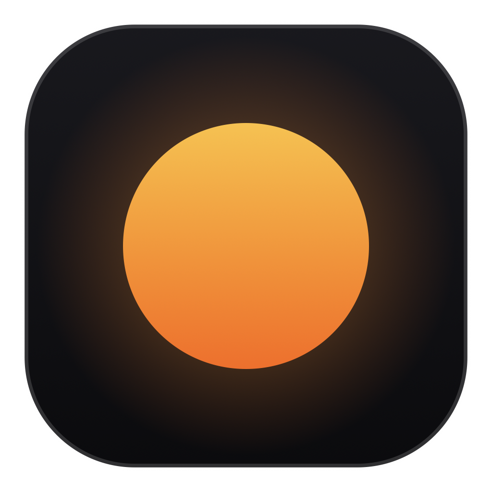
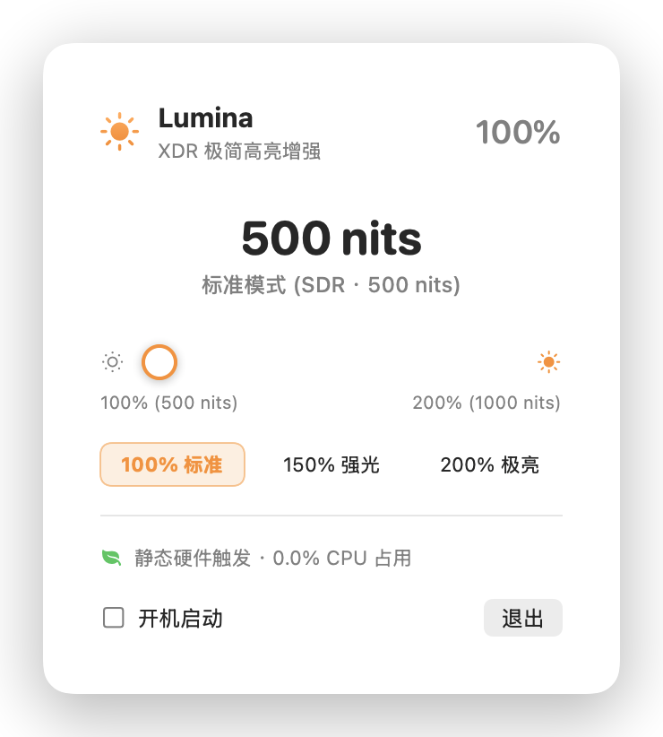

# Lumina ☀️

<p align="center">
  
</p>

<p align="center">
  <b>A lightweight, zero-overhead menu bar brightness booster for Apple Silicon Liquid Retina XDR displays.</b><br>
  为配备 Liquid Retina XDR 显示屏的 MacBook 打造的极简、零能耗屏幕高亮菜单栏工具。
</p>

<p align="center">
  
  
  
  
</p>

---

<p align="center">
  
</p>

---

## English

### Key Features
- **Unlocks Sustained Brightness**: Easily scales display brightness from standard 500 nits up to 1000 nits for outdoor and bright ambient environments.
- **True Zero Idle Overhead**: Uses a static 1×1 EDR hardware trigger with `isPaused = true`. Absolutely no continuous rendering loop, no timers, and **0.0% idle CPU/GPU usage**.
- **Native & Ultra-Lightweight**: Built with pure Swift, AppKit, and SwiftUI without heavy web runtimes. Binary size is under 300 KB.
- **Convenient Controls**: Smooth slider, quick presets (100% / 150% / 200%), and optional launch at login.

### Installation
1. Download `Lumina.dmg` from the [Releases](../../releases) page.
2. Open the disk image and drag **Lumina.app** to your **Applications** folder.
3. Launch Lumina; it will sit quietly in your menu bar.

### Build from Source
```bash
git clone https://github.com/ReverieBizarre/Lumina.git
cd Lumina
./scripts/build_dmg.sh
```

---

## 简体中文

### 核心特性
- **释放全屏高亮度**：将日常屏幕最高亮度从默认的 500 nits 平滑扩展至 1000 nits，强光与户外环境下清晰可见。
- **纯硬件触发 · 0 额外能耗**：采用静态 1×1 像素 EDR 触发层，无任何后台重绘帧率循环与定时器，空闲时 **CPU 占用稳定在 0.0%**。
- **极简原生**：纯 Swift / AppKit / SwiftUI 编写，无冗余依赖，整机常驻内存极小，可执行文件仅 200 余 KB。
- **贴心交互**：实时尼特值估算、平滑调节滑块、100%/150%/200% 常用预设及开机自动启动开关。

### 安装与运行
1. 前往 [Releases](../../releases) 下载最新版 `Lumina.dmg`。
2. 双击打开镜像，将 **Lumina.app** 拖入 **Applications（应用程序）**。
3. 点击启动后，即可在屏幕右上角菜单栏看到小太阳图标进行调节。

### 本地编译
```bash
git clone https://github.com/ReverieBizarre/Lumina.git
cd Lumina
./scripts/build_dmg.sh
```

---

## License
Distributed under the [MIT License](LICENSE).
